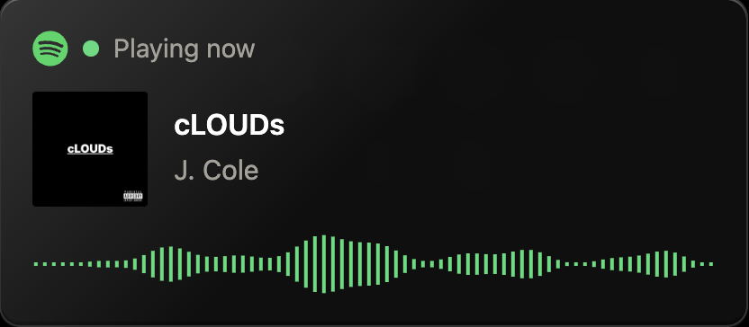

# Spotify Now Playing API

A small serverless API, deployed on Vercel, that returns the track that is currently streaming on Spotify as JSON, or the last track played if nothing is playing. It powers the "Currently listening to" widget on my portfolio: https://nullamnesiac.github.io

It has two endpoints: `/api/now-playing` (live Spotify data) and `/api/lastfm` (optional weekly top artists, tracks and albums from Last.fm).

The API exists so the Spotify credentials stay on the server. My portfolio is a static site, so anything placed in its code would be public.

## Preview



## How it works

1. The client calls `GET /api/now-playing`.
2. The function exchanges a long-lived Spotify **refresh token** for a short-lived access token.
3. It calls Spotify's `currently-playing` endpoint with that access token.
4. If nothing is playing (or the current item is a podcast or ad), it calls the `recently-played` endpoint and returns the most recent track instead, along with the time it was played.
5. It returns a simplified JSON response to the client.

Responses are cached at the edge for 10 seconds (`Cache-Control: s-maxage=10`), so frequent polling from the widget doesn't hit Spotify on every request.

## Response format

### `GET /api/now-playing`

While a track is playing:

```json
{
  "isPlaying": true,
  "title": "Track name",
  "artist": "Artist One, Artist Two",
  "albumImageUrl": "https://...",
  "songUrl": "https://open.spotify.com/track/...",
  "progressMs": 83000,
  "durationMs": 225000
}
```

`progressMs` is how far into the song I am and `durationMs` is the song's length, both in milliseconds. The portfolio uses them to draw a live progress bar: it takes the real position from each response, then counts forward locally between polls. Because of the 10 second cache, the position can be up to about 10 seconds behind.

When nothing is playing, the same fields are returned for the most recent track, with `isPlaying` set to `false` and a `playedAt` field added:

```json
{
  "isPlaying": false,
  "title": "Track name",
  "artist": "Artist One, Artist Two",
  "albumImageUrl": "https://...",
  "songUrl": "https://open.spotify.com/track/...",
  "playedAt": "2026-10-20T22:14:03.512Z"
}
```

`playedAt` is an ISO 8601 timestamp (UTC) from Spotify's `recently-played` endpoint, and marks when the track finished playing. The portfolio uses it to show how long ago I listened, in the style of phone notifications: "just now", "5 min ago", "3 hr ago" (minutes are dropped after the first hour), "yesterday", "4 days ago", and then a plain date after a week.

`playedAt` is only included for last-played tracks. If a track is paused, Spotify still reports it as the current item, so it comes back with `isPlaying: false` and no `playedAt`, and the widget shows just "Last played".

If no track is available, or Spotify returns an error:

```json
{ "isPlaying": false }
```

### `GET /api/lastfm`

Returns my top artists, tracks and albums (up to five of each) for a recent period. Last.fm decides the ranking and play counts, and Spotify supplies the links and pictures:

```json
{
  "available": true,
  "period": "7day",
  "profileUrl": "https://www.last.fm/user/...",
  "artists": [{ "name": "Artist", "plays": 41, "url": "https://open.spotify.com/artist/...", "image": "https://i.scdn.co/image/..." }],
  "tracks": [{ "name": "Track", "artist": "Artist", "plays": 12, "url": "https://open.spotify.com/track/...", "image": "https://i.scdn.co/image/..." }],
  "albums": [{ "name": "Album", "artist": "Artist", "plays": 30, "url": "https://open.spotify.com/album/...", "image": "https://i.scdn.co/image/..." }]
}
```

Each item is looked up through Spotify's search (using a client-credentials token, so no extra permissions are needed), and a result is only accepted if its artist name matches. If Spotify has no match or can't be reached, that item simply has no `url` or `image`, and the list still works. For tracks, `image` is the album cover.

The optional `period` query parameter accepts `7day` (default), `1month`, `3month`, `6month`, `12month` or `overall`. On any error, or if Last.fm is not configured, it returns `{ "available": false }` and the portfolio simply hides the extra tabs. Only `https://open.spotify.com/` links and `https://i.scdn.co/` images are passed through. Responses are cached for 10 minutes (`s-maxage=600`).

## Setup

### 1. Create a Spotify app

Create an app in the [Spotify Developer Dashboard](https://developer.spotify.com/dashboard) and note the **Client ID** and **Client Secret**. Add a redirect URI you control for the one-time authorization step.

### 2. Get a refresh token

Authorize your own Spotify account once using the [Authorization Code flow](https://developer.spotify.com/documentation/web-api/tutorials/code-flow) with these scopes:

- `user-read-currently-playing` for the live track
- `user-read-recently-played` for the last-played fallback and its `playedAt` time

Exchange the returned code for tokens and save the **refresh token**.

### 3. Set environment variables

| Variable | Description |
| --- | --- |
| `SPOTIFY_CLIENT_ID` | Client ID from your Spotify app |
| `SPOTIFY_CLIENT_SECRET` | Client secret from your Spotify app |
| `SPOTIFY_REFRESH_TOKEN` | Refresh token from step 2 |

On Vercel, add these under **Project Settings → Environment Variables**, then redeploy so they take effect. For local development, copy `.env.example` to `.env` and fill in the values. `.env` is listed in `.gitignore` and must never be committed.

### 4. Deploy

Import the repo into Vercel, set the environment variables, and deploy. The endpoint will be available at `https://<your-project>.vercel.app/api/now-playing`.

### 5. Optional: Last.fm top lists

1. Create a Last.fm account and connect Spotify so your plays are scrobbled (Last.fm → Settings → Applications). Only plays after connecting are counted.
2. Create an API key at https://www.last.fm/api/account/create. Only the API key is needed, not the shared secret.
3. Add these environment variables in Vercel:

| Variable | Description |
| --- | --- |
| `LASTFM_API_KEY` | API key from step 2 |
| `LASTFM_USERNAME` | Last.fm username, as it appears in `last.fm/user/<username>` |

4. Keep the function at `api/lastfm.js` and redeploy. It reuses `SPOTIFY_CLIENT_ID` and `SPOTIFY_CLIENT_SECRET` from step 3 to find Spotify links and pictures, so nothing else needs to be set. The endpoint will be available at `https://<your-project>.vercel.app/api/lastfm`.

## Security notes

- Credentials are read only from environment variables, never from source code.
- Spotify errors and missing configuration are logged server-side (in the Vercel logs). Callers only ever receive `{ "isPlaying": false }`, and unexpected errors return a generic 500 message, with no upstream error details.
- The Last.fm API key is read only from environment variables. The `lastfm` endpoint returns only `{ "available": false }` on failure, with no upstream error details.
- CORS is currently open (`Access-Control-Allow-Origin: *`) because the data is public now-playing info. It can be restricted to a single origin if needed.

## Tech

JavaScript (Node.js), Spotify Web API, Last.fm API, Vercel serverless functions.